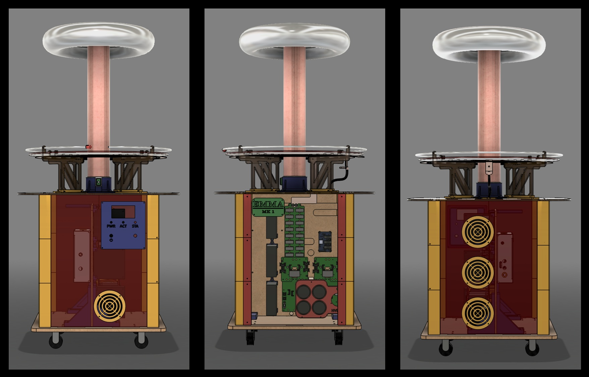

<figure>
  
  <figcaption align="center">Figure 1. <i>Emma Mk1</i> DRSSTC</figcaption>
</figure>

<h1>Brief</h1>

Electrical and mechanical design files for the <i>Emma Mk1 DRSSTC</i>.

<h1>Companion Repos</h1>

- [Emma Mk1 DRSSTC Fusion360 design files](https://github.com/muJoseph/Emma-Mk1-DRSSTC-Fusion360-Design)
- [Emma Mk1 DRSSTC firmware](https://github.com/muJoseph/DRSSTC_Driver)
- [Emma Mk1 DRSSTC software](https://github.com/muJoseph/Emma-Mk1-DRSSTC-Web-Controller)
- [DRSSTCToolbox](https://github.com/muJoseph/DRSSTCToolbox)


<h1>Emma Mk1 DRSSTC Project Live Documentation</h1>

<strong>[Emma Mk1 DRSSTC](https://www.mujoseph.com/projects/emma-mk1-drsstc)</strong>

<h1>File Structure</h1>

```text
Emma-Mk1-DRSSTC/
├── hardware/
│   ├── electrical/
│   │     └── <board_name>/                    # Emma Mk1 <board_name> PCB
│   │         ├── assembly/                    # pick-and-place, etc.
│   │         ├── fab/                         # gerbers, NC drill
│   │         ├── SCHEM-<board_name>.pdf       # schematic
│   │         └── BOM-<board_name>.xlsx        # BOM
│   ├── mechanical/
        ├── fab/
        │    └──<component>/                  # <component> fab files (e.g., .3mf, .step, .dxf, .gcode, etc.)
        └── img/                              # Emma Mk1 media
└── README.md
```
<h1>Additional Links</h1>

